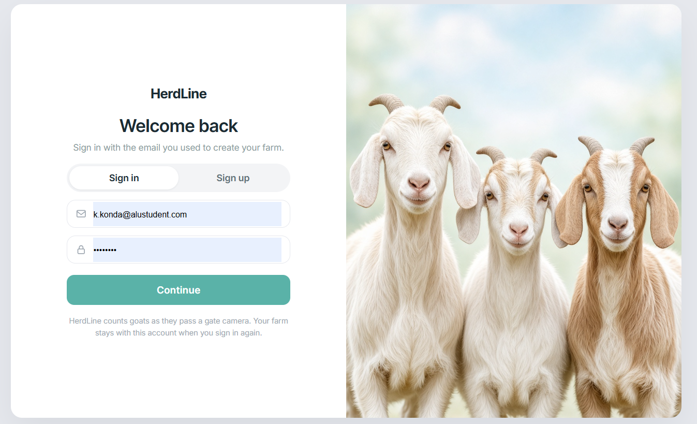
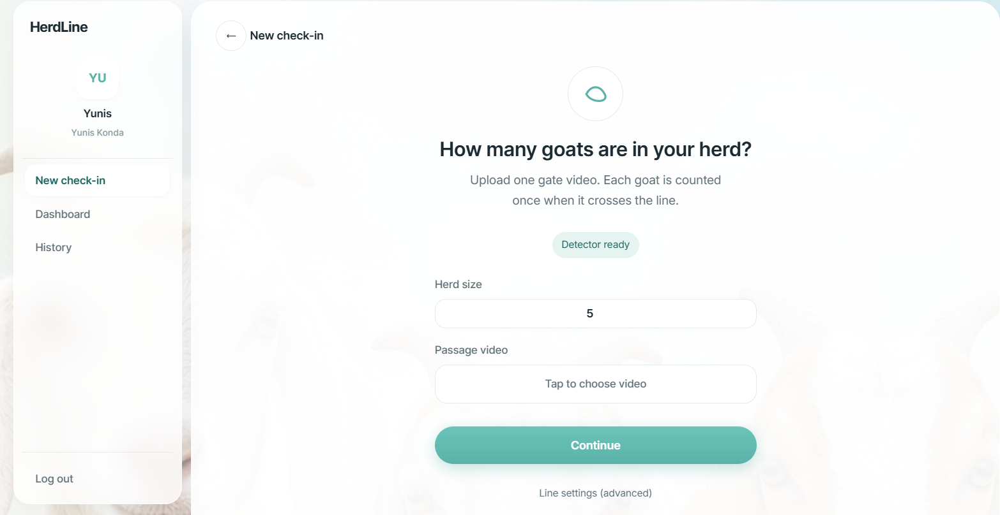
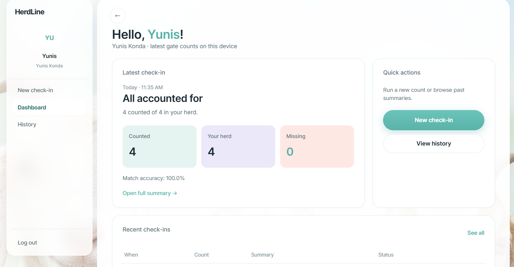
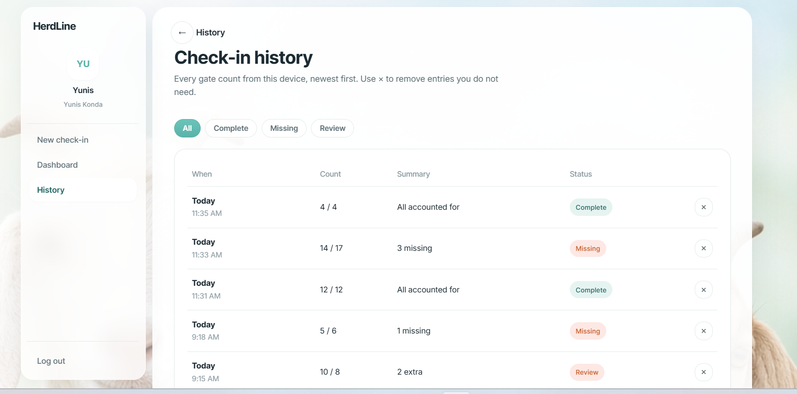

# HerdLine

Herdline is a machine learning model that automates goat counting under controlled conditions, with the main condition being a narrow gate. Sign in, upload a clip, enter the herd size, and see how many goats crossed the line.

Smallholder goat farmers count their herds manually every evening. When herds grow past 20–30 animals, counting becomes slow and error-prone, and missing goats are often noticed too late. HerdLine automates this using only a phone camera and a short video of goats passing through a narrow gate.

## Technical report and walkthrough video links

Technical report: https://docs.google.com/document/d/1S0U4iyM2_SAl05I1u3ZrIPhJz8awk9jPbzd87OAWZsw/edit?tab=t.29k08x4r9b8k

Demo Video: https://youtu.be/pmawrw_ACXE

## Screenshots

| Sign in | New check-in |
| --- | --- |
|  |  |

| Dashboard | History |
| --- | --- |
|  |  |

---

## Tech stack

| Layer | Tools |
|---|---|
| Detection | YOLOv8n (Ultralytics) |
| Tracking | ByteTrack |
| Backend | FastAPI + Uvicorn |
| Frontend | HTML, CSS, and Vanilla JavaScript |
| Deployment | Local (PyTorch), Cloudflare Tunnel for a public demo URL, and Render with `best.onnx` + ONNX Runtime |

---

## Setup

```bash
cd c:/capstone
python -m venv .venv
.venv\Scripts\activate
pip install -r requirements.txt
```

You need `models/weights/best.pt` (included). The training images are not in Git (~9 GB); only `data/goat.yaml` is included.

---

## Run

```bash
uvicorn web.app:app --reload --host 127.0.0.1 --port 8000
```

Open http://127.0.0.1:8000, sign up, start a check-in, and upload a short gate video with the herd size.

---

## Share a public URL (Cloudflare Tunnel)

For demos and remote testing, run the app on your laptop and expose it with **Cloudflare Tunnel**. Counting still runs on your machine — the tunnel only gives you an HTTPS link.

1. Start the app (keep this terminal open):

```bash
uvicorn web.app:app --host 0.0.0.0 --port 8000
```

2. In a second terminal, start the tunnel:

```bash
# Git Bash (this PC)
"/c/Program Files (x86)/cloudflared/cloudflared.exe" tunnel --url http://127.0.0.1:8000
```

```powershell
# PowerShell
& "C:\Program Files (x86)\cloudflared\cloudflared.exe" tunnel --url http://127.0.0.1:8000
```

3. Copy the `https://….trycloudflare.com` URL from the tunnel log and share it. Keep **both** terminals open while people test.

Full notes: [`docs/DEPLOY.md`](docs/DEPLOY.md).


---

## What's in the repo

| Path | Role |
|---|---|
| `src/` | Detect, track, count |
| `web/` | FastAPI site |
| `models/weights/best.pt` | Fine-tuned YOLOv8n goat detector (local / training) |
| `models/weights/best.onnx` | Same model for low-memory hosts (Render) |
| `config/bytetrack.yaml` | Tracker settings |
| `data/videos/evaluation/` | Sample gate clips (hand counts in the filenames) |
| `notebooks/goat_detection_and_counting.ipynb` | Training and evaluation notes |
| `docs/DEPLOY.md` | Cloudflare Tunnel / public demo URL |
| `docs/RENDER.md` | Render deploy with ONNX (no PyTorch) |
| `requirements-render.txt` | Slim pip deps for Render |

---

## How counting works

1. YOLOv8n (ONNX in production) finds goats in each frame.
2. Weak/odd / people-like boxes are filtered out.
3. A goat is counted **once** when its centre crosses a **fixed** yellow virtual gate line (default `x=0.5`, direction **`either`** so L→R and R→L both count; advanced form settings can lock one way).
4. **Herd size is not used to choose the line.** It is only compared afterward to show missing/extra animals.

The system counts first, then measures the error against the hand count.

```bash
python scripts/eval_fixed_line.py
```

Results are written to `outputs/results/fixed_line_eval.csv`.

### Fixed-line counting eval (app pipeline)

Same defaults for every clip: vertical line at **0.5**, direction **either**.

| Video | Expected | System | Error | Misses | Extras | Accuracy | Time (s) |
| --- | ---: | ---: | ---: | ---: | ---: | ---: | ---: |
| test_video_4_goats.mp4 | 4 | 3 | -1 | 1 | 0 | 0.750 | 14.8 |
| test_video_5_goats.mp4 | 5 | 4 | -1 | 1 | 0 | 0.800 | 8.3 |
| test_video_6_goats.mp4 | 6 | 6 | +0 | 0 | 0 | 1.000 | 18.5 |
| test_video_8_goats.mp4 | 8 | 6 | -2 | 2 | 0 | 0.750 | 42.9 |
| test_video_12_goats.mp4 | 12 | 8 | -4 | 4 | 0 | 0.667 | 84.3 |
| test_video_17_goats.mp4 | 17 | 5 | -12 | 12 | 0 | 0.294 | 42.3 |

Mean counting accuracy on this set: **0.710**. Sparse clips are within 0–2 animals; dense/crowded gates (especially 17) still undercount.

---

## Notebook

Open `notebooks/goat_detection_and_counting.ipynb` for preprocessing, the Faster R-CNN baseline, YOLOv8n training, and metrics.

- **Validation metrics at the end of training:** precision 0.91, recall 0.76, mAP@50 0.84, F1 ≈ 0.83.
- **Test-set metrics (held-out split):** precision 0.90, recall 0.74, F1 0.81, mAP@50 0.82.
- **Gate-video counting:** use `scripts/eval_fixed_line.py` / the table above (fixed line; herd size for comparison only).

---

## Dataset

- **CherryChevre** — public goat dataset used for training and evaluation.
- Training images (~9 GB) are kept locally and are not included in the repo.
- Only `data/goat.yaml` is included so the data path can be reproduced.

---

## Known limitation

Recall on real gate video is lower than on still images. Animals that never cross the fixed line are missed. Crowding and occlusion cause undercounts on large herds. Non-goat videos should return 0 / rejected rather than a fitted herd number. 

---

## License

Released for academic and research use. Third-party libraries retain their original licenses (Ultralytics AGPL-3.0, ByteTrack MIT, FastAPI MIT). Contact the author before commercial use.

---

## Contact

- **Author:** Kumi Yunis Konda — k.konda@alustudent.com
- **Supervisor:** Hubert Apana
- **Institution:** African Leadership University, BSc Software Engineering
