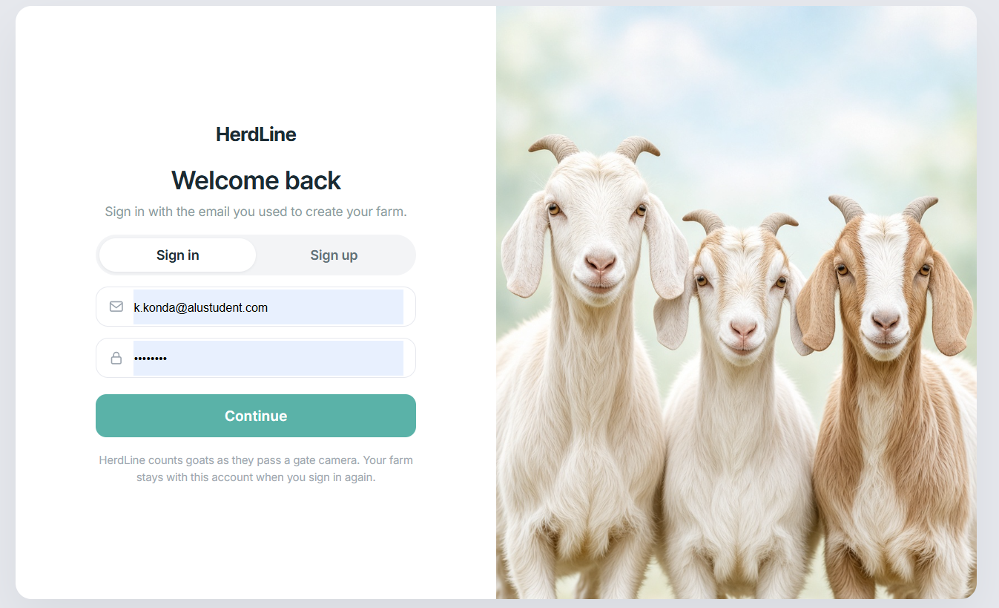
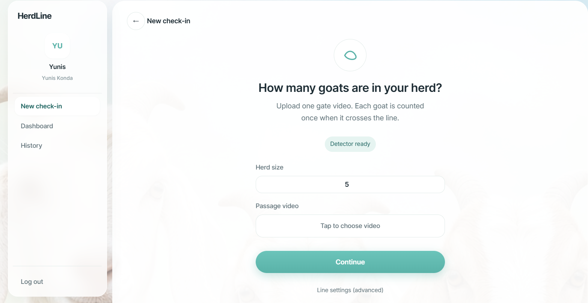
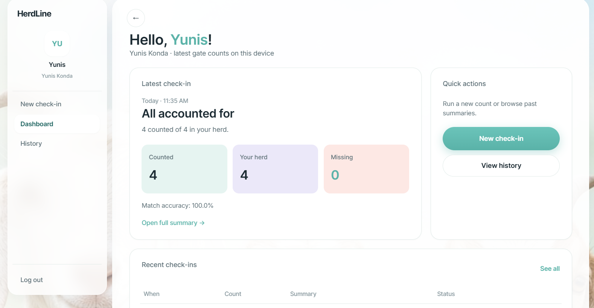
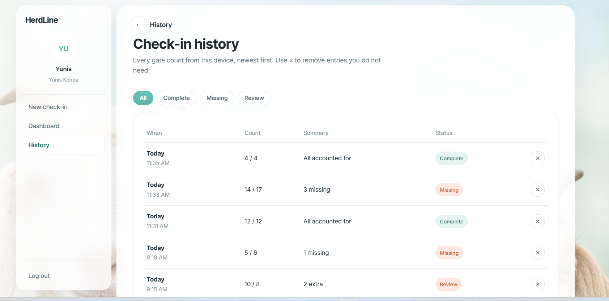

# HerdLine

Herdline is a machine learning model that automates goat counting under controlled conditions, main condion being a narrow gate. Sign in, upload a clip, enter the herd size, and see how many goats crossed the line.

Smallholder goat farmers count their herds manually every evening. When herds grow past 20–30 animals, counting becomes slow and error-prone, and missing goats are often noticed too late. HerdLine automates this using only a phone camera and a short video of goats passing through a narrow gate.

## Technical report and walkthrough video links

Technical report: https://docs.google.com/document/d/1S0U4iyM2_SAl05I1u3ZrIPhJz8awk9jPbzd87OAWZsw/edit?tab=t.29k08x4r9b8k

Demo Video: https://youtu.be/pmawrw_ACXE

## Screenshots

| Sign in | New check-in |
| --- | --- |
|  |  |

| Dashboard | History |
| --- | --- |
|  |  |

---

## Tech stack

| Layer | Tools |
|---|---|
| Detection | YOLOv8n (Ultralytics) |
| Tracking | ByteTrack |
| Backend | FastAPI + Uvicorn |
| Frontend | HTML,CSS and Vanilla Javascript |
| Deployment | Local (PyTorch) or Render with `best.onnx` + ONNX Runtime |

---

## Setup

```bash
cd c:/capstone
python -m venv .venv
.venv\Scripts\activate
pip install -r requirements.txt
```

You need `models/weights/best.pt` (included). The training images are not in Git (~9 GB); only `data/goat.yaml` is included.

---

## Run

```bash
uvicorn web.app:app --reload --host 127.0.0.1 --port 8000
```

Open http://127.0.0.1:8000, sign up, start a check-in, and upload a short gate video with the herd size.

---

## What's in the repo

| Path | Role |
|---|---|
| `src/` | Detect, track, count |
| `web/` | FastAPI site |
| `models/weights/best.pt` | Fine-tuned YOLOv8n goat detector (local / training) |
| `models/weights/best.onnx` | Same model for low-memory hosts (Render) |
| `config/bytetrack.yaml` | Tracker settings |
| `data/videos/evaluation/` | Sample gate clips (hand counts in the filenames) |
| `notebooks/goat_detection_and_counting.ipynb` | Training and evaluation notes |
| `docs/DEPLOY.md` | How to share a public test URL |
| `docs/RENDER.md` | Render deploy with ONNX (no PyTorch) |
| `requirements-render.txt` | Slim pip deps for Render |

---

## How counting works

1. YOLOv8n finds goats in each frame.
2. Weak or odd boxes are filtered out.
3. A goat is counted **once** when its centre crosses the yellow virtual gate line.
4. If the herd size is given, the walk direction and line position are chosen to match that size as closely as possible.


---

## Notebook

Open `notebooks/goat_detection_and_counting.ipynb` for preprocessing, the Faster R-CNN baseline, YOLOv8n training, and metrics.

- **Validation metrics at the end of training:** precision 0.91, recall 0.76, mAP@50 0.84.
- **Test-set metrics (held-out split):** precision 0.90, recall 0.74, F1 0.81, mAP@50 0.82.


---

## Dataset

- **CherryChevre** — public goat dataset used for training and evaluation.
- Training images (~9 GB) are kept locally and are not included in the repo.
- Only `data/goat.yaml` is included so the data path can be reproduced.

---

## Known limitation

Recall on real gate video is lower than on still images. The system might end undercounting or overcounting at some instances. 

---

## License

Released for academic and research use. Third-party libraries retain their original licenses (Ultralytics AGPL-3.0, ByteTrack MIT, FastAPI MIT). Contact the author before commercial use.

---

## Contact

- **Author:** Kumi Yunis Konda — k.konda@alustudent.com
- **Supervisor:** Hubert Apana
- **Institution:** African Leadership University, BSc Software Engineering
