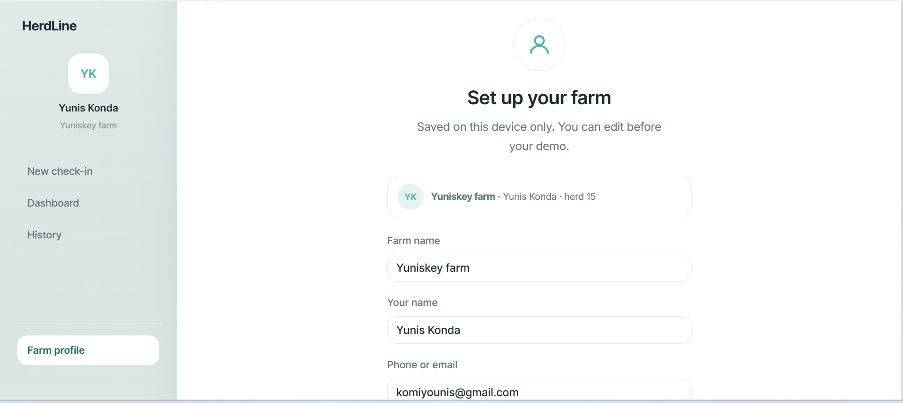
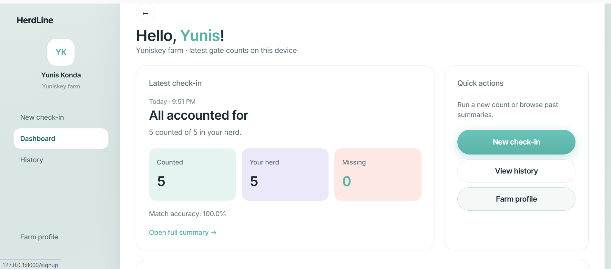

# HerdLine 

**A machine learning goat counting system that helps farmers verify their herd returned home — using only a phone camera and a short gate video.**

---

## The Problem

Smallholder goat farmers in South and North Kordofan, Sudan, count their herds manually every evening. When herds grow past 20–30 animals, manual counting becomes slow, error-prone, and stressful. Missing goats are often noticed too late, and there is no record of daily attendance. Existing solutions — ear tags, microchips, RFID — are expensive, require special readers, and stress the animals.

## The Solution

HerdLine lets a farmer:

1. Sign in with a farm profile and expected herd size.
2. Upload a short video of goats passing through a narrow gate.
3. Get an automatic count of goats that crossed a virtual line.
4. See a summary: counted, missing, or extra goats — with an annotated video.

The system uses **YOLOv8n** for goat detection and **ByteTrack** for tracking, then counts each goat once as it crosses a virtual line. No special hardware is required beyond a smartphone.

## Demo

- 🎥 **Demo video:** [https://youtu.be/s_iRQ79fcIs](https://youtu.be/s_iRQ79fcIs)
- 🌐 **Public test URL:** see [`docs/DEPLOY.md`](docs/DEPLOY.md)

### Screenshots

| Farm profile | New check-in |
|---|---|
|  |  |

| Summary | History |
|---|---|
|  |  |

## Key Features

- **Automatic goat counting** from a single gate video
- **Herd-size comparison** — instantly shows missing or extra goats
- **Annotated output video** with boxes, track IDs, and the counting line
- **Per-farm accounts** with sign-up, login, and check-in history
- **No special hardware** — works with any smartphone video
- **Lightweight inference** — ONNX export for low-resource deployment

## How It Works

```
Gate video
    │
    ▼
┌─────────────────┐
│ YOLOv8n detector│  → goat bounding boxes per frame
└─────────────────┘
    │
    ▼
┌─────────────────┐
│    ByteTrack    │  → temporary ID per goat, resilient to flicker
└─────────────────┘
    │
    ▼
┌─────────────────┐
│  Line counter   │  → counts each ID once on the entry side
└─────────────────┘
    │
    ▼
┌─────────────────┐
│  Herd summary   │  → counted vs. expected → missing / extra
└─────────────────┘
```

1. Each frame is passed through the fine-tuned YOLOv8n goat detector.
2. ByteTrack assigns a temporary ID to each goat.
3. Track memory preserves the ID when a box flickers for a few frames.
4. A goat is counted once when its track crosses the virtual line.
5. The total is compared with the herd size entered by the farmer.

## Model Performance

Evaluated on a held-out test split of the CherryChevre dataset:

| Metric | Score |
|---|---:|
| Precision | 0.90 |
| Recall | 0.74 |
| F1 | 0.81 |
| mAP@50 | 0.82 |

> **Note:** Recall (0.74) means roughly 1 in 4 goats may be missed in crowded or low-contrast frames. See [Limitations](#limitations--ethical-notes).

## Tech Stack

| Layer | Tools |
|---|---|
| Detection | YOLOv8n (Ultralytics) |
| Tracking | ByteTrack |
| Backend | FastAPI + Uvicorn |
| Frontend | Jinja2 templates (sign-up, check-in, history) |
| Storage | Per-browser history (prototype) |
| Deployment | ONNX Runtime (for low-memory hosts) |
| Dataset | CherryChevre (public goat dataset) |

## Project Structure

```
herdLine/
├── notebooks/
│   └── goat_detection_and_counting.ipynb   # Data, training notes, scores
├── models/
│   └── weights/
│       ├── best.pt                         # Fine-tuned YOLOv8n (PyTorch)
│       └── best.onnx                       # Exported for lightweight deployment
├── src/                                    # Detect, track, count, save results
├── web/                                    # FastAPI app + templates
├── config/
│   └── bytetrack.yaml                      # Tracker settings
├── docs/
│   ├── DEPLOY.md                           # How to share a public test link
│   └── screenshots/                        # UI screenshots for the report
├── data/
│   └── goat.yaml                           # Dataset config (images not in repo)
├── requirements.txt
└── README.md
```

> **Dataset note:** The CherryChevre images in `data/train`, `data/valid`, and `data/test` (~9 GB) stay on your machine and are **not** uploaded to GitHub.

## Quick Start

### Prerequisites

- Python 3.9+
- `pip`
- (Optional) A virtual environment

### Install

```bash
git clone https://github.com/Yunis-konda001/herdLine.git
cd herdLine
python -m venv .venv

# Windows
.venv\Scripts\activate
# macOS / Linux
source .venv/bin/activate

pip install -r requirements.txt
```

### Run the website

```bash
uvicorn web.app:app --reload --host 127.0.0.1 --port 8000
```

Open [http://127.0.0.1:8000](http://127.0.0.1:8000).

### (Optional) Use the ONNX model

To run with the lighter ONNX model instead of PyTorch:

```python
from ultralytics import YOLO
model = YOLO("models/weights/best.onnx")
```

Then update `web/app.py` to load `best.onnx` instead of `best.pt`.

## Usage Walkthrough

1. **Sign up** — email, password, farm name, herd size.
2. **New check-in** — enter herd size and upload a gate video.
3. **Summary** — see counted goats, missing or extra, and the annotated video.
4. **History** — view past check-ins for that account.
5. **Log out** when finished.

## API Endpoints

| Method | Path | Purpose |
|---|---|---|
| `GET` | `/` | Landing / login page |
| `POST` | `/signup` | Create a farm account |
| `POST` | `/login` | Authenticate |
| `GET` | `/checkin` | Upload form |
| `POST` | `/checkin` | Process a gate video and return a summary |
| `GET` | `/history` | List past check-ins |
| `POST` | `/logout` | Clear session |

*(Adjust this table to match your actual routes in `web/app.py`.)*

## Dataset & Attribution

- **Dataset:** CherryChevre (public goat dataset).
- **Model:** YOLOv8n, fine-tuned by the author.
- **Tracker:** ByteTrack (MIT license).
- **Frameworks:** Ultralytics (AGPL-3.0), FastAPI (MIT).

If you reuse this code, please retain the licenses and attribution above.

## Limitations & Ethical Notes

- **Recall = 0.74** — roughly 1 in 4 goats may be missed in crowded or low-contrast frames. The system is a **decision-support tool**, not a replacement for human verification.
- **Controlled conditions** — best results with a narrow passage, fixed camera angle, and good daylight.
- **Dataset bias** — CherryChevre may not represent all Sudanese goat breeds or lighting conditions.
- **No personal data** — videos show only goats; any accidental human face is blurred before use.
- **Prototype storage** — check-in history is stored per browser; it is not a production database.
- **Research context** — developed as an ALU BSE capstone project. Not for commercial deployment without further validation.

## Roadmap

- [ ] Per-farm database (replace browser-local history)
- [ ] Mobile-friendly upload from phone camera
- [ ] Improve recall with hard-negative mining
- [ ] Multi-line counting for wider gates
- [ ] Offline mode (on-device inference)

## License

This project is released for **academic and research use**. Third-party libraries retain their original licenses (see [Dataset & Attribution](#dataset--attribution)). Contact the author before commercial use.

## Author

**Kumi Yunis Konda**
BSc. Software Engineering, African Leadership University
k.konda@alustudent.com
[github.com/Yunis-konda001](https://github.com/Yunis-konda001)

**Supervisor:** Hubert Apana